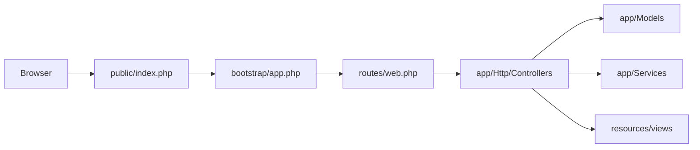

# Arquitectura — Camiglobo (demo estilo Laravel)

## Aviso

Este repositorio es una **demo de arquitectura**. No es el código desplegado en Hostinger.  
Producción: [camiglobo.com](https://camiglobo.com) (document root `public_html` en el hosting).

## Visión

Separar responsabilidades como en un framework PHP moderno:

| Capa | Ruta | Rol |
|---|---|---|
| Entrypoint | `public/` | Único punto HTTP documentado |
| Bootstrap | `bootstrap/app.php` | Carga de la app (stub) |
| Rutas | `routes/web.php` | Mapa URL → controlador |
| Controllers | `app/Http/Controllers/{Dominio}` | Orquestación por dominio |
| Models | `app/Models/` | Acceso a datos (stubs) |
| Services | `app/Services/` | Reglas de negocio / email / precios |
| Views | `resources/views/` | Layouts y plantillas |
| Config | `config/` | Ajustes y `.env-example` |
| Storage | `storage/app/uploads/` | Ficheros de usuario |

## Dominios de controladores

- **Shop** — catálogo, carrito, checkout, personalizador, legales, sitemaps
- **Auth** — login, registro, recuperación, Google OAuth
- **Account** — perfil y pedidos del cliente
- **Admin** — productos, pedidos, pagos, biblioteca, newsletter
- **Api** — endpoints AJAX, pago, uploads, recursos

## Flujo de una petición (conceptual)

## Qué es stub y qué es código real

- **Código real movido:** páginas PHP del e-commerce agrupadas en `app/Http/Controllers/*`, layouts en `resources/views/layouts/`, config y PHPMailer.
- **Stubs de framework:** `Models/*`, `Services/*Service.php`, `public/index.php`, `bootstrap/app.php`, `routes/web.php`.
- **No incluido:** autoload Composer completo, migraciones con datos, ni un kernel HTTP ejecutable.

## Seguridad

- No versionar `.env` real (ver `.gitignore`).
- Uploads de usuario bajo `storage/` (ignorados salvo `.gitkeep`).
- Credenciales y dumps sensibles fuera del repo.
